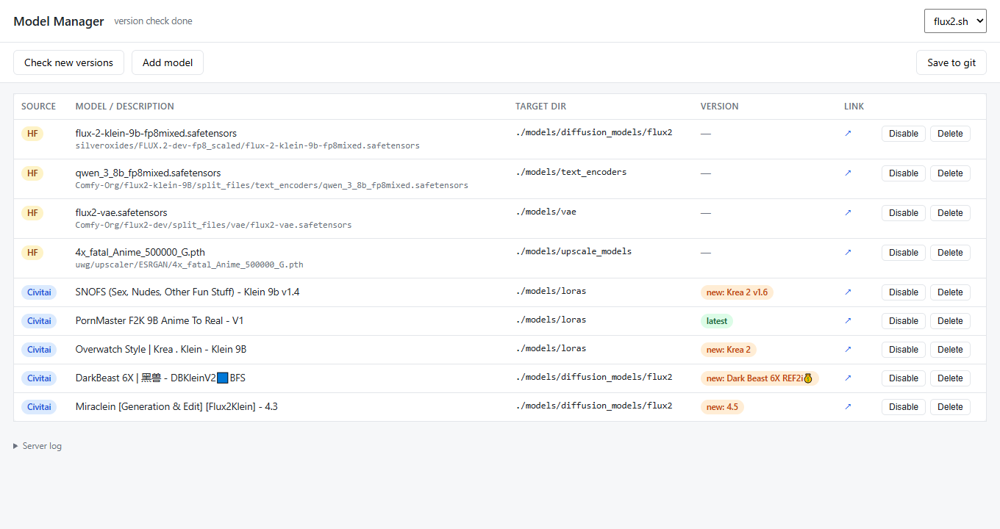

# Vast ComfyUI Provision Script Manager

A local web UI that turns your bash **provision scripts** from a wall of shell lines into a
clickable table of models — with Civitai version checks, one-click add/delete, and git-based
sync to your Vast.ai server over SSH.



## The problem

Running AI workloads on [Vast.ai](https://vast.ai) means working in the console and repeating
the same steps over and over on every instance: installing ComfyUI, then downloading models,
loras, VAEs and text encoders from Civitai and HuggingFace.

The usual solution is a **provision script** — a bash file that runs when the instance starts
and downloads every model automatically. But the scripts themselves become the new problem:

- you cannot see *what* a script downloads without reading it line by line;
- checking whether a pinned Civitai version is still the latest means opening the site and
  comparing version IDs by hand;
- adding one model means writing yet another download line — and remembering which download
  helper and argument style *that particular script* uses;
- active and commented-out entries are mixed together with no overview.

If you have ever looked for a solution, you already know why: version checks and model
installation are too many repetitive steps for what they achieve.

## What this tool does

`model_manager.ps1` is a **single-file PowerShell tool**. Drop it into the folder that holds
your `*.sh` provision scripts, run it, and it opens a local web UI that:

- **lists every `*.sh` script** in the folder and parses all model download calls inside —
  Civitai (`civitai download`, `--version`, `--model`, custom helper functions) and
  HuggingFace (`hf download`, `download_hf_file` helpers, `wget` of resolve URLs),
- shows **source badges** (Civitai / HF), the parsed target dir, file names, sizes and
  direct links for every entry, including commented-out ones (shown dimmed as `off`),
- **Check new versions** — queries the Civitai API for every active civitai entry and marks
  each one `latest` (green) or `new: <version>` (orange, clicking it opens the new version
  on civitai.com). HF entries are intentionally not checked — HF files have no meaningful
  version concept,
- **Add model** — paste a Civitai or HuggingFace URL, the tool resolves it through the public
  APIs (model name, version, primary file, size; or a file picker for a whole HF repo) and
  inserts the download line in the exact call style that script already uses,
- **Disable / Enable** any entry (comments out / uncomments the block in the script) and
  **Delete** it — edits land on disk immediately, as UTF-8 without BOM with LF endings
  (bash-safe), with a one-shot `*.sh.bak` backup per session,
- **Save to git** — one button that commits the current script and pushes it to GitHub.

## Sync with your server over SSH

The classic Vast.ai workflow: your provision script lives in a git repository, and your
instance pulls or runs it over SSH at start.

1. Edit the model list in the UI (add, disable, delete).
2. Press **Save to git** — the tool commits and pushes the script.
3. On the server, `git pull` over SSH — or simply start the next instance from the updated
   script. The instance now downloads exactly the model list you saw in the UI.

## Usage

```powershell
# put model_manager.ps1 into the folder with your *.sh provision scripts
cd C:\path\to\your\provision-scripts
powershell -ExecutionPolicy Bypass -File .\model_manager.ps1
```

The UI opens at `http://localhost:8766` (the port auto-increments if taken). Useful flags:

```powershell
-Port 8800          # fixed port
-NoBrowser          # do not auto-open the browser
-ScriptsDir <path>  # manage scripts in another folder
```

### Requirements

- Windows PowerShell 5.1 or 7
- git (for the **Save to git** button)
- optional: `CIVITAI_TOKEN` environment variable — sent as a Bearer token to reduce
  Civitai API rate limiting during version checks

## Safety

- The HTTP listener binds to `localhost` only, embeds a per-session random token into the
  page and rejects cross-origin requests.
- The UI never rewrites anything until *you* click Delete / Disable / Insert.
- Before the first mutation of a script in a session, a sidecar backup `<name>.sh.bak` is
  written; the folder being a git repository is the primary recovery path.
- Script names are strictly validated — no path traversal, only top-level `*.sh` files.

## Notes

- Only top-level `*.sh` files in the scripts folder are listed.
- Civitai version checks use the public API without auth unless `CIVITAI_TOKEN` is set;
  entries that fail to resolve degrade to `unknown` instead of blocking the rest.
- Parsing is non-destructive: the tool reads your scripts, it does not reformat them.

---

If you like it, please rate it — give the repo a ⭐ or drop feedback in the issues.
